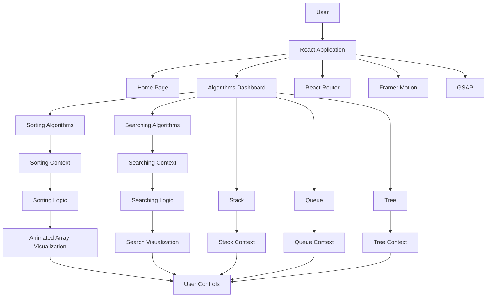

<div align="center">

# 🚀 SortifyDSA

### Interactive Data Structures & Algorithms Visualizer

**Understand. Visualize. Explore. Master DSA.**


</div>

---

## 📖 Overview

**SortifyDSA** is an interactive Data Structures and Algorithms visualization platform designed to make learning complex programming concepts easier through visual demonstrations and step-by-step execution.

The platform allows users to explore different sorting and searching algorithms, understand their working mechanisms, and observe how data changes during algorithm execution.

Users can customize input arrays, control visualization speed, pause and resume execution, and explore detailed algorithm explanations, time complexities, and code implementations in multiple programming languages.

The application also provides interactive visualizations of fundamental data structures such as Stacks, Queues, and Trees.

---

## 📸 Screenshots

<table>
  <tr>
    <td width="50%" align="center">
      <strong>Home Page</strong><br/><br/>
    
    </td>
    <td width="50%" align="center">
      <strong>Algorithms Dashboard</strong><br/><br/>
      
    </td>
  </tr>
  <tr>
    <td width="50%" align="center">
      <strong>Sorting Visualization</strong><br/><br/>
      
    </td>
    <td width="50%" align="center">
      <strong>Searching Visualization</strong><br/><br/>
      
    </td>
  </tr>
  <tr>
    <td width="50%" align="center">
      <strong>Stack Visualization</strong><br/><br/>
    
    </td>
    <td width="50%" align="center">
      <strong>Queue Visualization</strong><br/><br/>
    
    </td>
  </tr>
  <tr>
    <td width="50%" align="center">
      <strong>Linked List Visualization</strong><br/><br/>
     
    </td>
    <td width="50%" align="center">
      <strong>Sliding Window Visualization</strong><br/><br/>
     
    </td>
    <td width="50%" align="center">
      <strong>Algorithm Theory & Code</strong><br/><br/>
      
    </td>
    <td width="50%" align="center">
      <strong>AI Chatbot Assistent</strong><br/><br/>
      
    </td>
  </tr>
</table>

---

## ✨ Key Features

| Feature | Description |
|---|---|
| 📊 **Interactive Sorting** | Visualize sorting algorithms through animated array bars. |
| 🔍 **Searching Algorithms** | Understand how elements are located using different searching techniques. |
| 🎮 **Step-by-Step Visualization** | Observe comparisons and changes during algorithm execution. |
| ⚡ **Speed Control** | Adjust the execution speed of visualizations. |
| 📏 **Array Size Control** | Customize the number of elements in an array. |
| ✏️ **Custom Array Input** | Enter your own array to visualize algorithm behavior. |
| 🎲 **Random Array Generation** | Generate random arrays for experimentation. |
| ⏯️ **Play & Pause Controls** | Start, pause, resume, and reset algorithm execution. |
| 📚 **Algorithm Theory** | Learn algorithm definitions and working mechanisms. |
| 💻 **Multi-Language Code** | Explore algorithm implementations in multiple programming languages. |
| 📈 **Time Complexity Analysis** | Understand best, average, and worst-case time complexities. |
| 📦 **Stack Visualization** | Perform Push, Pop, Top, and Empty operations interactively. |
| 🚶 **Queue Visualization** | Perform Enqueue, Dequeue, Front, and Empty operations interactively. |
| 🌳 **Tree Visualization** | Explore tree structures and level-order traversal components. |
| 🎨 **Animated UI** | Experience smooth transitions and interactive animations. |
| 📱 **Responsive Interface** | Access the application across different screen sizes. |

---

## 🧮 Algorithms Implemented

### 1. Sorting Algorithms

SortifyDSA provides interactive visualizations for the following sorting algorithms:

| Algorithm | Description |
|---|---|
| Bubble Sort | Repeatedly compares adjacent elements and swaps them when necessary. |
| Selection Sort | Selects the smallest element and places it in its correct position. |
| Insertion Sort | Builds a sorted array by inserting elements into their appropriate positions. |
| Merge Sort | Uses divide and conquer to divide, sort, and merge arrays. |
| Quick Sort | Uses a pivot element to partition and sort an array. |
| Heap Sort | Uses a heap data structure to sort elements. |
| Counting Sort | Sorts elements using frequency counting. |
| Radix Sort | Sorts numbers digit by digit. |
| Shell Sort | Improves insertion sort using gap-based comparisons. |

### 2. Searching Algorithms

| Algorithm | Description |
|---|---|
| Linear Search | Checks elements sequentially until the target is found. |
| Binary Search | Repeatedly divides a sorted search space into smaller halves. |

### 3. Data Structures

| Data Structure | Operations / Functionality |
|---|---|
| Stack | Push, Pop, Top, and Empty |
| Queue | Enqueue, Dequeue, Front, and Empty |
| Tree | Tree structure and level-order traversal components |

---

## 🏗️ Application Architecture

SortifyDSA follows a component-based React architecture.

The application uses React Context API to manage shared visualization states and control algorithm execution.

React Router handles navigation between different algorithm visualizations, while Framer Motion and GSAP provide interactive animations.



---

## 🛠️ Tech Stack

<div align="center">

### Frontend


### Styling


### Animation & UI


### Development Tools


</div>

---

## ⚙️ Getting Started

Follow these steps to run SortifyDSA locally.

### Prerequisites

- Node.js (18 or later recommended)
- npm
- Git

### 1. Clone the Repository

```bash
git clone <your-repository-url>
```

### 2. Navigate to the Project Directory

```bash
cd SortifyDSA
```

### 3. Install Dependencies

```bash
npm install
```

### 4. Start the Development Server

```bash
npm run start
```

### 5. Open the Application

Visit the following URL in your browser:

```text
http://localhost:5173
```

---

## 📂 Project Structure

```text
SortifyDSA/
│
├── public/
│   └── favicon.ico
│
├── src/
│   │
│   ├── components/
│   │   ├── Navbar.jsx
│   │   ├── Home.jsx
│   │   ├── Headers.jsx
│   │   ├── Features.jsx
│   │   ├── Algorithms.jsx
│   │   ├── Footer.jsx
│   │   ├── comingSoon.jsx
│   │   │
│   │   ├── Sorting/
│   │   │   ├── sorting.jsx
│   │   │   ├── SortingComp.jsx
│   │   │   ├── sortingTheory.jsx
│   │   │   ├── algoButton.jsx
│   │   │   ├── bars/
│   │   │   │   └── barFunction.jsx
│   │   │   └── sorting_algo/
│   │   │       ├── bubbleSort.jsx
│   │   │       ├── selectionSort.jsx
│   │   │       ├── insertationSort.jsx
│   │   │       ├── mergeSort.jsx
│   │   │       ├── quickSort.jsx
│   │   │       ├── heapSort.jsx
│   │   │       ├── countingSort.jsx
│   │   │       ├── radixSort.jsx
│   │   │       └── shellSort.jsx
│   │   │
│   │   ├── Searching/
│   │   │   ├── searching.jsx
│   │   │   ├── SearchingComp.jsx
│   │   │   ├── searchingTheory.jsx
│   │   │   ├── searchingalgo.jsx
│   │   │   ├── SearchingComp.jsx
│   │   │   ├── bar/
│   │   │   │   ├── BinarySearchBar.jsx
│   │   │   │   └── linearSearchBar.jsx
│   │   │   └── searching_algo/
│   │   │       ├── binarySearch.jsx
│   │   │       └── linearSearch.jsx
│   │   │
│   │   ├── Stack/
│   │   │   └── stackComp.jsx
│   │   │
│   │   ├── queue/
│   │   │   └── queueComp.jsx
│   │   │
│   │   └── tree/
│   │       ├── treeComp.jsx
│   │       ├── treeNodeComp.jsx
│   │       ├── treeStructure.jsx
│   │       └── levelOrderTree.jsx
│   │
│   ├── context/
│   │   ├── algoControlContext.jsx
│   │   ├── stackContext.jsx
│   │   ├── queueContext.jsx
│   │   └── treeContext.jsx
│   │
│   ├── utils/
│   │   ├── commanFn.jsx
│   │   ├── sortingType.jsx
│   │   ├── searchingType.jsx
│   │   ├── stackFunctions.jsx
│   │   ├── queueFunctions.jsx
│   │   ├── treeFunction.jsx
│   │   │
│   │   └── data/
│   │       ├── algorithmsData.jsx
│   │       ├── sortingData.jsx
│   │       ├── searchingData.jsx
│   │       ├── stackData.jsx
│   │       └── queueData.jsx
│   │
│   ├── index.css
│   └── index.jsx
│
├── index.html
├── package.json
├── package-lock.json
├── tailwind.config.js
├── vite.config.js
└── README.md
```

---

## 🎮 How to Use SortifyDSA

1. Open the application and explore the home page.
2. Navigate to the Algorithms section.
3. Select a sorting or searching algorithm.
4. Generate a random array or enter a custom array.
5. Adjust the array size and visualization speed.
6. Click Start to begin the visualization.
7. Pause, resume, or reset the execution.
8. Explore the algorithm theory, complexity analysis, and code implementations.
9. Navigate to Stack or Queue to experiment with their operations.
10. Explore the available Tree visualization.

---

## 📚 Learning Resources Inside the Application

Each sorting and searching algorithm provides educational information, including:

- Algorithm Definition
- Working Explanation
- Step-by-Step Visualization
- Best-Case Time Complexity
- Average-Case Time Complexity
- Worst-Case Time Complexity
- Code Implementations in Multiple Languages

These resources help learners understand not only how an algorithm works but also its performance and practical behavior.

---

## 🚀 Future Enhancements

- Graph algorithm visualizations.
- Additional tree traversal algorithms.
- Linked list visualizations.
- Backtracking algorithm demonstrations.
- More interactive learning exercises.
- Additional algorithm implementations.

---

<div align="center">

## 🌟 SortifyDSA

**Making Data Structures & Algorithms easier to understand, one visualization at a time.**

*Learn by seeing. Understand by doing.*

</div>
